<div align="center">

<!-- ╔══════════════════════════════════════════════════════════════╗ -->
<!--             ⚡ CYBERNETIC HUD // DYNAMIC HEADER ⚡             -->
<!-- ╚══════════════════════════════════════════════════════════════╝ -->


<br>


<br>

<!-- CYBER LASER DIVIDER -->


<br>

<!-- ANIMATED CYBERPUNK CODER VISUAL -->


<br><br>

<!-- REALTIME STATUS PILLS -->


<br><br>

<!-- QUICK SOCIAL MATRIX -->
<a href="https://github.com/Parthp-stack" target="_blank">
  
</a>
&nbsp;
<a href="https://www.linkedin.com/" target="_blank">
  
</a>
&nbsp;
<a href="mailto:parthpatil@example.com" target="_blank">
  
</a>

<br><br>

<!-- PROFILE TELEMETRY COUNTER -->


</div>

<br>

<!-- ╔══════════════════════════════════════════════════════════════╗ -->
<!--                  🛸 SYSTEM ARCHIVE // ABOUT ME                 -->
<!-- ╚══════════════════════════════════════════════════════════════╝ -->


<div align="center">

## 📡 `// SYSTEM_SPECIFICATION :: ABOUT_ME`

<!-- ANIMATED CYBERNETIC HUD GRAPHIC -->


<br><br>

<!-- ANIMATED CYBER GLOBE & MISSION BANNER -->


<br>


</div>

<br>

<!-- ╔══════════════════════════════════════════════════════════════╗ -->
<!--               🛰️ ARCHITECTURAL PILLARS (HUD GRID)              -->
<!-- ╚══════════════════════════════════════════════════════════════╝ -->

<div align="center">

## 🛰️ `// CORE_MODULES :: ARCHITECTURAL_PILLARS`

<table border="0">
<tr>
<td align="center" width="225" style="border: 1px solid #00E5FF; border-radius: 8px; padding: 15px; background: #05070F;">

### 💻 `[ BUILD ]`
**Full-Stack Ecosystems**
<br>
<sub>Robust backends, responsive UIs, clean RESTful architectures and reactive interfaces.</sub>

</td>

<td align="center" width="225" style="border: 1px solid #00E5FF; border-radius: 8px; padding: 15px; background: #05070F;">

### 🧠 `[ SOLVE ]`
**Algorithmic Mastery**
<br>
<sub>Deep dive into Data Structures, Complexity Optimization, and OOP paradigms.</sub>

</td>

<td align="center" width="225" style="border: 1px solid #00E5FF; border-radius: 8px; padding: 15px; background: #05070F;">

### 🤖 `[ EXPLORE ]`
**AI & Data Science**
<br>
<sub>Data Wrangling, Statistical Inference, Predictive Modeling and ML Integration.</sub>

</td>

<td align="center" width="225" style="border: 1px solid #00E5FF; border-radius: 8px; padding: 15px; background: #05070F;">

### 🚀 `[ SHIP ]`
**Production Deployment**
<br>
<sub>Version-controlled code, containerized environments, testing and live deployments.</sub>

</td>
</tr>
</table>

</div>

<br>

<!-- ╔══════════════════════════════════════════════════════════════╗ -->
<!--     FEATURE 2: 🪐 ORBITING TECH SATELLITE RADAR SYSTEM        -->
<!-- ╚══════════════════════════════════════════════════════════════╝ -->


<div align="center">

### 🧰 LOADED ARSENAL MODULES
<a href="https://skillicons.dev">
  
</a>

<br><br>

### 📊 DATA INTELLIGENCE & MACHINE LEARNING


</div>

<br>

<!-- ╔══════════════════════════════════════════════════════════════╗ -->
<!--     FEATURE 3: 🛸 HOLOGRAPHIC PROJECT HOLO-DECK (BUILDS)      -->
<!-- ╚══════════════════════════════════════════════════════════════╝ -->


<div align="center">

## 🛸 `// HOLO_DECK :: FEATURED_SYSTEMS`

<table>
<tr>
<td width="300" style="background: #050a18; border: 1.5px solid #00E5FF; border-radius: 10px; padding: 18px;">

<div align="center">

### 🤖 `NEURAL-SENTINEL`


<p align="left" style="font-size: 0.9em; color: #8b949e;">
Real-time AI-driven Predictive Analytics &amp; Anomaly Detection engine. Analyzes continuous data streams with neural inferences.
</p>

`Python` • `PyTorch` • `FastAPI` • `Docker`

<br>

<a href="https://github.com/Parthp-stack" target="_blank">
  
</a>

</div>

</td>

<td width="300" style="background: #050a18; border: 1.5px solid #00FFA3; border-radius: 10px; padding: 18px;">

<div align="center">

### 🌐 `QUANTUM-NEXUS`


<p align="left" style="font-size: 0.9em; color: #8b949e;">
Full-stack enterprise distributed dashboard and RESTful API infrastructure with real-time state synchronization.
</p>

`React` • `Node.js` • `Express` • `MySQL`

<br>

<a href="https://github.com/Parthp-stack" target="_blank">
  
</a>

</div>

</td>

<td width="300" style="background: #050a18; border: 1.5px solid #b388ff; border-radius: 10px; padding: 18px;">

<div align="center">

### ⚡ `ALGO-MATRIX`


<p align="left" style="font-size: 0.9em; color: #8b949e;">
High-performance algorithmic complexity visualizer. Benchmarks pathfinding, graph models, and dynamic programming.
</p>

`C++` • `Algorithms` • `DSA` • `OOP`

<br>

<a href="https://github.com/Parthp-stack" target="_blank">
  
</a>

</div>

</td>
</tr>
</table>

</div>

<br>

<!-- ╔══════════════════════════════════════════════════════════════╗ -->
<!--   FEATURE 4: 📂 INTERACTIVE CLASSIFIED TERMINAL EASTER EGG    -->
<!-- ╚══════════════════════════════════════════════════════════════╝ -->

<div align="center">

<details>
<summary style="font-family: monospace; font-size: 1.1em; cursor: pointer; color: #00E5FF; padding: 12px; border: 1px solid #00E5FF; border-radius: 8px; background: #050a1a; display: inline-block;">
  <b>⚡ [ ACCESS LEVEL 5 CLEARANCE // CLICK TO REVEAL CLASSIFIED_LOGS.EXE ]</b>
</summary>

<br><br>

<div align="left" style="max-width: 800px; margin: 0 auto; background: #030612; border: 1px solid #00ffa3; border-radius: 8px; padding: 20px; font-family: monospace; color: #e6edf3;">

```bash
> ACCESS GRANTED // CREDENTIALS VERIFIED: PARTH_PATIL
> DECRYPTING OPERATIONAL LOGS... [DONE]

[+] MISSION DIRECTIVE    : Engineer intelligence at scale.
[+] 2026-2027 ROADMAP    : 
    - Master Autonomous LLM Agents & Reinforcement Learning
    - Scale Distributed Microservices to 100K+ RPS
    - Deepen Advanced Graph Neural Networks (GNNs)
[+] EASTER EGG DISCOVERED: 
    "Technology is best when it brings people together. 
     Code is poetry written for machines to empower humans."

> LOGS SECURED // SESSION TERMINATED_
```

</div>

</details>

</div>

<br>

<!-- ╔══════════════════════════════════════════════════════════════╗ -->
<!--                 🧬 ANIMATED EXECUTION PIPELINE                 -->
<!-- ╚══════════════════════════════════════════════════════════════╝ -->


<div align="center">

## 🧬 `// EXECUTION_FLOW :: PIPELINE_MATRIX`

<!-- ANIMATED PIPELINE SVG -->


<br><br>

<!-- MATRIX CODE STREAM VISUAL -->


</div>

<br>

<!-- ╔══════════════════════════════════════════════════════════════╗ -->
<!--      📊 GITHUB TELEMETRY & METRICS (IMMUNE TO RATE LIMITS)     -->
<!-- ╚══════════════════════════════════════════════════════════════╝ -->


<div align="center">

## 📊 `// TELEMETRY :: QUANTUM_METRICS`

<!-- ANIMATED CUSTOM TELEMETRY GAUGE -->


<br><br>

<!-- GITHUB STREAK STATS -->


<br><br>

<!-- PROFILE DETAILS & LANGUAGE SUMMARY -->


<br><br>


&nbsp;


</div>

<br>

<!-- ╔══════════════════════════════════════════════════════════════╗ -->
<!--                  🐍 CONTRIBUTION GRID MATRIX                   -->
<!-- ╚══════════════════════════════════════════════════════════════╝ -->

<div align="center">

## 🐍 `// NEURAL_GRID :: ACTIVITY_MATRIX`

<br>


<br>


</div>

<br>

<!-- ╔══════════════════════════════════════════════════════════════╗ -->
<!--                 ⚡ HARDWARE & MENTALITY DIALECTIC               -->
<!-- ╚══════════════════════════════════════════════════════════════╝ -->


<div align="center">

## ⚡ `// CORE_PHILOSOPHY :: DEV_MINDSET`


<br>

<!-- HOLOGRAPHIC SCI-FI RADAR -->


<br><br>

> *"The best way to predict the future is to write the code that creates it."*

</div>

<br>

<!-- ╔══════════════════════════════════════════════════════════════╗ -->
<!--                     📡 TRANSMISSION & CONNECT                  -->
<!-- ╚══════════════════════════════════════════════════════════════╝ -->


<div align="center">

## 📡 `// FREQUENCY :: INITIATE_COMMUNICATION`

<br>

<a href="https://github.com/Parthp-stack" target="_blank">
  
</a>
&nbsp;
<a href="https://www.linkedin.com/" target="_blank">
  
</a>
&nbsp;
<a href="mailto:parthpatil@example.com" target="_blank">
  
</a>

<br><br>


</div>

<br>

<!-- ╔══════════════════════════════════════════════════════════════╗ -->
<!--               ⚡ CYBERNETIC HUD // FOOTER WAVE ⚡               -->
<!-- ╚══════════════════════════════════════════════════════════════╝ -->


<div align="center">

### `PARTHP-STACK` // SECURE ARCHITECTURE • DATA SCIENCE • AI ENGINE
<sub>Crafted with passion for futuristic software engineering</sub>

<br>


</div>
